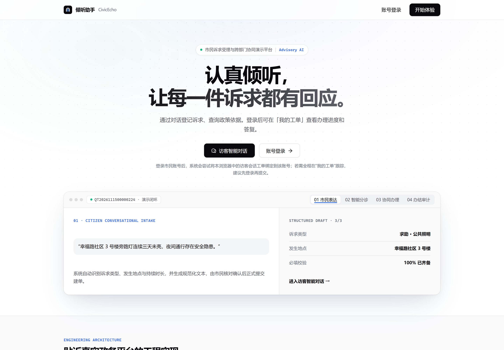
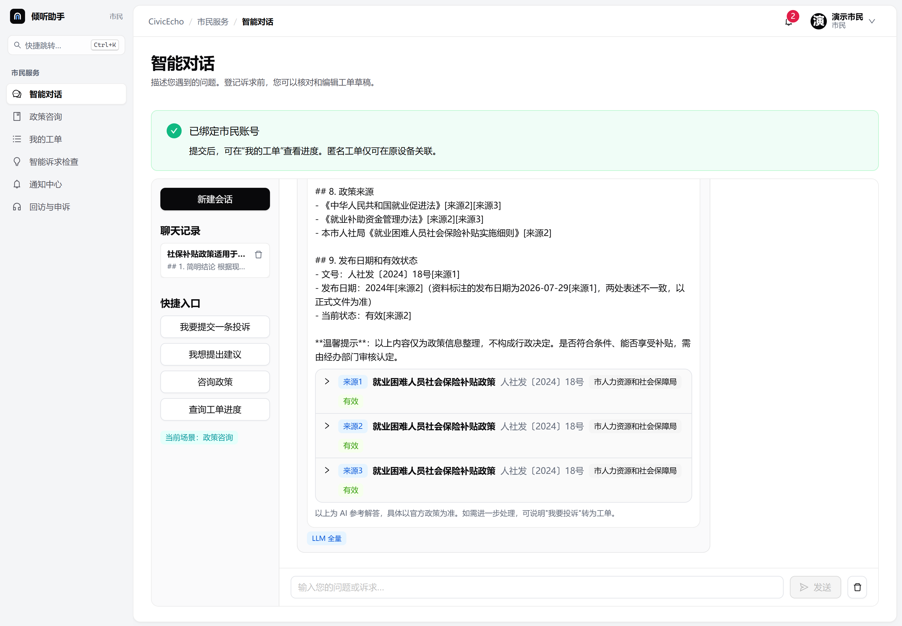
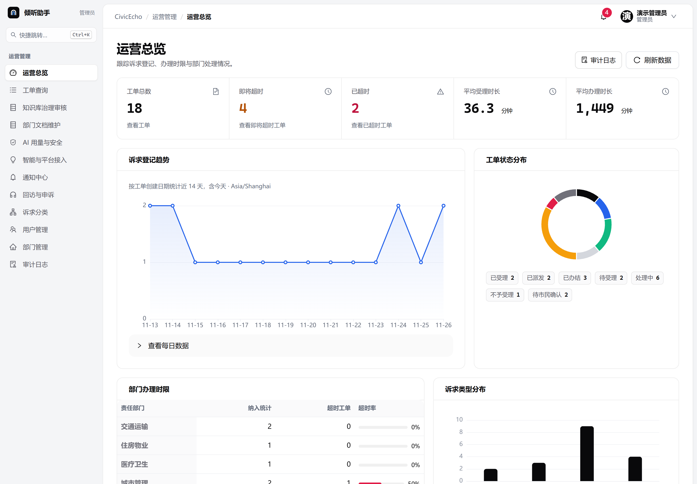

# CivicEcho v2 · 倾听助手

CivicEcho（AI-Powered Citizen Request Coordination Platform）是一个面向市民诉求与跨部门协同办理的政务演示项目。市民通过对话咨询政策、核对并提交工单，坐席完成受理和派发，部门协同办理，管理员跟踪进度和审计记录。

AI 提供带来源的政策答复、工单草稿和办件建议。工单的受理、派发、复核与办结由有权限的人员确认。

## 界面预览



| 市民流式政策咨询 | 管理员运营总览 |
| --- | --- |
|  |  |

查看 [坐席批量派发](docs/images/workspace/agent-batch-1440.png) · [部门 PDF 预览](docs/images/workspace/department-pdf-1440.png) · [实时通知](docs/images/workspace/citizen-notifications-1440.png) · [移动端工单草稿](docs/images/workspace/citizen-draft-390.png)

## 功能与业务流程

| 角色 | 可以做什么 |
| --- | --- |
| 市民 | 自助注册和改密、流式政策咨询、核对工单草稿、跟踪进度、评价与申诉 |
| 坐席 | 查看 AI 分诊建议、受理、批量派发、复核部门结果、导出工单 CSV |
| 部门 | 按状态和时限筛选任务、协同办理、预览附件、汇总结果并提交复核 |
| 管理员 | 查看登记趋势和办理时限、管理账号和知识库、审计操作并导出 CSV |

工单主流程为 **市民建单 → 坐席受理与派发 → 部门办理 → 坐席复核 → 市民评价**。通知经 SSE 更新，工单详情支持打印。演示数据包含近 14 天的 18 条工单和 PDF、PNG 附件。

## 快速开始

需要 Git、PowerShell 和已启动的 Docker Desktop（Docker Compose v2）。

```powershell
git clone https://github.com/TTzz1z/CivicEcho-AI-Powered-Citizen-Request-Coordination-Platform.git
cd CivicEcho-AI-Powered-Citizen-Request-Coordination-Platform
Copy-Item .env.example .env
notepad .env
```

在 `.env` 中分别生成并填写 `POSTGRES_PASSWORD`、`JWT_SECRET`、`SERVICE_API_TOKEN` 和 `SEED_PASSWORD`，四个值须互不相同。前两者分别至少 12 和 32 个字符，后两者分别至少 24 和 12 个字符。模板默认使用本地规则，DeepSeek 和 SiliconFlow 密钥均为可选配置。

```powershell
.\scripts\check-demo.ps1 -Start -Build
```

启动后打开 [演示前端](http://localhost:8080) 或 [开发 API 文档](http://localhost:8001/docs)。如修改过端口，以脚本输出为准。

| 角色 | 演示用户名 |
| --- | --- |
| 市民 | `citizen_local` |
| 坐席 | `agent_local` |
| 部门专员（综合受理） | `department_local` |
| 管理员 | `admin_local` |

四个演示账号使用你在本机设置的 `SEED_PASSWORD`。工单演示步骤见 [五分钟演示指南](docs/DEMO.md)。

## 技术栈与部署

- **前端**使用 React、TypeScript 和 Ant Design，Nginx 提供页面并代理 API。
- **后端**使用 FastAPI 处理工单、权限和 AI 对话。PostgreSQL 保存业务记录与知识索引，pgvector 和 pg_trgm 支持混合检索。数据库迁移由 Alembic 管理。
- **异步处理**由 Worker 跟踪办理时限并投递通知。前端通过 SSE 接收通知和 AI 增量答复。
- **对象存储与安全**方面，演示环境使用 MinIO。生产配置使用 Caddy、SeaweedFS 和 ClamAV，关闭演示入口和 API 文档。

运行配置与恢复步骤见 [部署指南](docs/DEPLOYMENT.md)。自动化验证由 [GitHub Actions 工作流](.github/workflows/ci.yml) 运行。

## 许可证

项目按 Apache License 2.0 发布。 [许可证](LICENSE) · [第三方声明](NOTICE.md)
